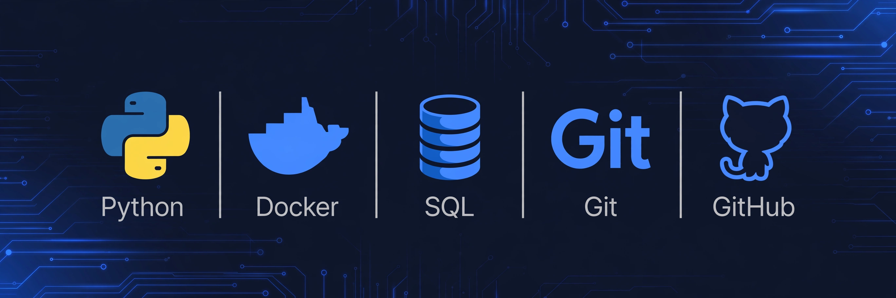

<div align="center">



# OMAR VELA LOBO
### INGENIERO DE SISTEMAS E INFORMÁTICA

<p>
  <b>Pucallpa, Ucayali, Perú</b> | 
  <a href="mailto:alev9770@gmail.com">alev9770@gmail.com</a> | 
  <a href="https://github.com/OmarVLobo">github.com/OmarVLobo</a>
</p>

<p>
  
  
  
  
</p>

</div>

---

### ● RESUMEN PROFESIONAL

> Ingeniero de Sistemas e Informática con **más de 10 años de experiencia** en análisis, diseño, implementación y monitoreo de sistemas de información. Trayectoria en sector público y privado con proyectos de gran escala a nivel nacional (JNE, ONPE, INEI, MINEDU). **Tecnología / Lógica / Soluciones.**

### ● STACK TÉCNICO 2026

**Desarrollo:** Python (PyCharm 2025.2), Java (NetBeans 22), .NET (VS 2022)
**Bases de Datos:** SQL Server 2022, MySQL Workbench, SQL (Simplilearn 2026)
**DevOps:** Git (Feb 2026), Docker (IBM Mar 2026), GitHub Flow
**Ciberseguridad:** Cisco Intro to Cybersecurity (Ene 2026)

### ● PROYECTO BANDERA

**[MicroApp Logística Ventas – Python + Docker + GitHub](https://github.com/OmarVLobo/MicroAppLogisticaVentas)**
`Python 3.11 | Docker 211MB | GitHub`

MicroApp modular (Main / Clases / Funciones) con validaciones try/except, reportes auditables y Dockerizada con volumen persistente.

```bash
docker build -t microapp-log-vent .
docker run -it --rm -v ${PWD}/data:/app/data microapp-log-vent
